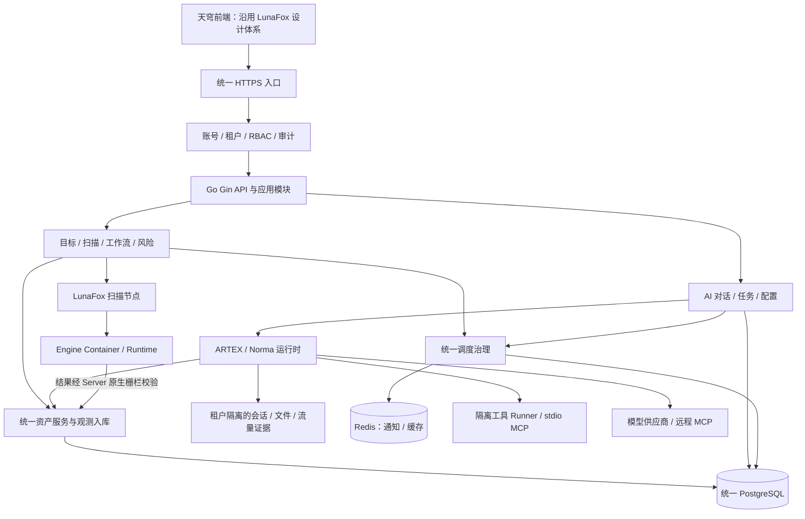

# 总体架构与功能实施方案

本文为天穹的目标设计，全部新增模块、路由和工作流均为待实现项。源码事实和验证边界见 [源码核查](01-源码核查与复用清单.md)。

## 1. 实施原则与架构决定

采用 **LunaFox 产品基座 + ARTEX/Norma 能力移植 + 应用接口适配** 的模块化 Go 后端。

| 决定 | 具体做法 | 原因 |
| --- | --- | --- |
| 一个产品入口 | LunaFox 前端统一导航、认证、主题和数据请求，品牌展示为“天穹” | 保持现有操作习惯和视觉体系 |
| 一个核心 API | 在 LunaFox Gin/bootstrap 注册新应用模块，使用既有 `/v1` 边界 | 共享身份、事务、资产与审计 |
| 保留成熟 AI 核心 | 迁移 ARTEX 的 ChatAgent、MainAgent、Goals、Planner、Worker、Engine 等，继续依赖 Norma `v0.4.3` | 对等保留 Agent 的执行和上下文机制 |
| 统一存储所有权 | 同一个 PostgreSQL；LunaFox 原表保留，新能力用明确的新表和 Port | 资产与 AI 状态可做同事务关联 |
| 统一调度治理 | 一个服务生命周期、准入、配额、实例去重与恢复机制；保留 Cron/时间窗口/事件三种规则 | 兼顾任务语义与执行可靠性 |
| 工具隔离运行 | AI 编排位于 Go 核心；Bash、文件工具、脚本、交互 Shell 和 stdio MCP 在受控 Runner 执行 | 工具执行不获得核心服务或其他租户的数据权限 |
| 保留扫描节点边界 | Server 继续使用原 Agent/Engine 合同，AI 调用扫描应用服务 | 当前节点没有可修改源码，不破坏已签名产物与协议 |

禁止采用 iframe、页面跳转到另一产品、双登录、直接反向代理整个 ARTEX `/api`、后台循环同步两套独立资产主库等融合方式。也不把 ARTEX 简化成一次普通 LLM 请求。

## 2. 目标系统结构



Go 核心可以拆为 API 与后台角色运行同一代码，但不出现第二个 ARTEX 业务系统。第一阶段优先单实例编排；生产多实例依赖持久租约和恢复验收后开放。Redis 不作为任务或资产的唯一事实源。

隔离 Runner 是天穹的执行适配器，仅暴露内部执行协议；不提供独立产品 UI、账号或资产库。对外业务数据仍由核心应用拥有。

## 3. 目录与模块安排

```text
SkyShield/
├── frontend/                     # 从 LunaFox 建立产品前端基线
│   ├── app/ai/                   # 对话、工具执行、任务、计划任务
│   ├── app/assets/               # 统一资产入口
│   ├── app/settings/ai/          # LLM、Agent、MCP、Skill、工具
│   ├── components/ai/            # 业务展示组件，复用现有 UI 基础
│   ├── hooks/                    # 租户化 Query Key、轮询、订阅、操作
│   ├── services/                 # /v1 DTO、分页与错误适配
│   └── types/                    # 前端领域类型
├── server/
│   ├── cmd/server/               # 唯一核心入口及编号迁移
│   ├── cmd/tool-runner/          # 内部隔离工具执行角色
│   └── internal/
│       ├── bootstrap/            # 原有组装，新增明确 wiring
│       ├── modules/
│       │   ├── identity/         # 扩展租户、成员、角色、授权
│       │   ├── asset/            # 保留现有类型 Facade
│       │   ├── assetregistry/    # 统一资产身份、归属、关系、观测
│       │   ├── scan/             # 保留扫描业务
│       │   ├── resultingest/     # 保留扫描授权栅栏和结果事务
│       │   ├── security/         # 原风险能力及 AI 发现关联
│       │   ├── aiworkbench/      # 对话、任务、图、执行记录、发现
│       │   ├── aisettings/       # LLM、Agent、MCP、Skill、工具配置
│       │   ├── scheduling/       # 公共准入/租约/幂等/规则处理器
│       │   └── audit/            # 统一操作与安全审计
│       └── airuntime/            # ARTEX/Norma 迁移核心，不依赖 Gin
├── contracts/                    # 保留 LunaFox 外部协议
├── engine-go/                    # 保留公开 SDK
├── extensions/                   # 引擎及工作流
├── resources/                    # 指纹、字典等
├── deploy/                       # 天穹自身构建、配置和发布清单
└── docs/                         # 中文设计、运行和交付记录
```

新业务模块遵守 LunaFox 的 Domain/Application/Repository/DTO/Handler/Router 边界及 `ports.go`、`exports.go` 规则。ARTEX 代码迁移位置在来源清单逐文件记录；不把它整体塞进一个新 Handler。

初次建立基线时保留 LunaFox Go module/import 路径、协议包名与产物标识，避免为了更名改动全部成熟代码。产品名称、页面标题、站点元数据、部署项目名和构建输出使用天穹/SkyShield；涉及签名或协议的原标识不做字符串批量替换。

## 4. 菜单与页面

沿用 LunaFox 现有侧栏和分组；新增项如下，其余原功能完整保留。

| 菜单位置 | 页面 | 路由设计 | 主要行为 |
| --- | --- | --- | --- |
| 资产与风险 | **资产** | `/assets/` | 六类资产、企业范围、来源、覆盖图、详情、批量操作 |
| AI 工作台 | AI 对话 | `/ai/chat/` | 独立会话、Agent 与模型选择、活动和审批 |
| AI 工作台 | 工具执行 | `/ai/tool-executions/` | 历史、过滤、统计、输入输出详情 |
| AI 工作台 | AI 任务 | `/ai/tasks/`、`/ai/tasks/[id]/` | 自主任务和人工协同 |
| AI 工作台 | AI 计划任务 | `/ai/schedules/` | 任务运行窗口、关联任务、历史 |
| 系统 → **AI 设置** | LLM | `/settings/ai/llm/` | 模型连接、参数、优先级、重试、限流和连通测试 |
| 系统 → AI 设置 | Agent 设置 | `/settings/ai/agents/` | 内置/自定义 Agent、Prompt、工具及模型绑定、预算和触发器 |
| 系统 → AI 设置 | MCP | `/settings/ai/mcp/` | stdio/HTTP/SSE 配置、发现、缓存、可见性 |
| 系统 → AI 设置 | Skill | `/settings/ai/skills/` | 目录、文件、导入导出、Agent 绑定和使用记录 |
| 系统 → AI 设置 | 工具 | `/settings/ai/tools/` | 内置与自定义工具、描述/default、执行配置及授权 |

现有“节点”页面继续管理扫描节点；“Agent 设置”管理 AI 角色。两者使用不同类型、标识和说明，不能把一个扫描节点显示成 AI 人格配置。

审批记录、拦截规则、流量、报告、复测等与任务紧密相关的能力保留在 AI 任务详情和 AI 设置的相关子页/页签中，避免为每个上游路由都扩充一级菜单。原 ARTEX 入口全部建立到新入口的功能映射，不因导航收敛丢失能力。

### 4.1 视觉及前端实现要求

- 保留 LunaFox 的侧栏宽度和展开行为、顶部工具区、Page Shell、浅色/深色主题、语义图标、字体与密度、表格工具栏、分页、详情抽屉、按钮及反馈。
- 颜色、间距、圆角、字重、动效使用现有 Token/公共组件。ARTEX 的独立主题、字体预设、整套 Layout 和依赖 lockfile 不移入。
- 复用 ARTEX 的对话活动解析、类型与交互算法；将页面数据流接入 LunaFox `hooks/services/api-client`。
- 对话：左侧会话列表，右侧消息与执行过程，工具调用/审批卡片、底部输入区；具体尺寸和容器风格按 LunaFox 的组件规范。
- 任务：采用 LunaFox 列表和详情结构，任务详情提供总览、会话、探索图、资产/覆盖、发现/复测、流量、审批和报告等视图。
- 重型图表、Markdown 和终端按路由延迟加载。只引入经功能验证需要的 ARTEX 新依赖，先验证与 Next 15/React 19.1 的兼容性。
- 默认交付简体中文文案；沿用 next-intl 组织消息，新增文案进入语言资源，不在组件拼接多套语言系统。

## 5. 功能对等清单

“完整对等”是行为与数据对等，不要求复制 ARTEX 的 URL、页面布局、全局管理员模型或未经隔离的宿主机权限。

### 5.1 AI 对话

| 编号 | 必须保留的行为 | 落地要求 |
| --- | --- | --- |
| C01 | 独立多轮会话、历史恢复、标题/置顶/删除、停止执行 | 保存原始 Transcript 与展示活动；UI 刷新不丢执行状态 |
| C02 | 任意已启用、已授权 AI Agent 对话 | 按租户与 Agent 版本解析 Prompt、模型、Skill、MCP 和工具 |
| C03 | 模型流式/非流式、思考/文本/工具活动、Token 消耗 | 保留 ARTEX Capture 事件语义；计量不依赖调试录制开关 |
| C04 | 通用工具、文件与附件、可选 WebSearch、MCP/Skill 延迟工具 | 同参数及结果适配，文件引用绑定会话/任务与租户 |
| C05 | 上下文压缩、可选 noa、预算及收尾 | 保留 Compaction、Settlement、Resume 的执行机制 |
| C06 | 人在环路、审批、侧问和中断原因 | 共用审批账本和执行上下文，保留正确恢复位置 |
| C07 | 任务中的 MainAgent 对话与新建分段 | 可以读图、下发 hint/intent、设目标/约束、纠偏 worker；独立对话不隐式获得这些能力 |

### 5.2 工具执行与设置

| 编号 | 必须保留的行为 | 落地要求 |
| --- | --- | --- |
| E01 | 查询所有工具的调用历史和错误结果 | 来源包括 AI 任务和独立对话，按 tool_call_id 精确配对 |
| E02 | 任务、会话、工具、关键字、状态、时间等筛选和分页 | 统计和列表使用同一过滤集；范围包含当前租户和资源权限 |
| E03 | 原始入参、输出、错误、耗时与使用详情 | 大输出通过受控 artifact 获取，列表不携带完整大正文 |
| E04 | 内置工具目录、Agent 绑定、描述和 default 编辑 | 保留代码 handler 所有权，不允许数据库篡改内置工具执行实现 |
| E05 | 自定义 command/script/http/shell 工具、延迟发现 | 保留现有工具种类和绑定方式；测试调用同样进入执行隔离与审计 |

工具执行页面不额外引入任意宿主机命令入口。需要工具调试时在工具设置内提供授权的测试操作，仍走统一执行接口。

### 5.3 AI 任务

| 编号 | 必须保留的行为 | 关键复用 |
| --- | --- | --- |
| T01 | 创建、分类、名称/备注、置顶、模板、排队与并发配置 | Manager、task_categories、task_templates、队列规则 |
| T02 | 目标拆解 → 规划 → 意图领取 → 多 Worker 执行 | Goals、Planner、Worker、事件驱动 Engine |
| T03 | 图的节点/边、事实、目标证明、冷图摘要、继承及任务关系 | ExplorationStore、coldgraph、digest、task_relations |
| T04 | 启动/暂停/恢复/停止、单意图控制、实时纠偏 | 命名取消原因、执行上下文、steer_work 和 kill_work |
| T05 | 任务时限、步数与 Token 配额、超时收尾 | TaskClock、wrapup、timeout coordinator、LLM usage |
| T06 | 任务/Agent 模型绑定、模型链和故障切换 | task_llm、LLM pool/health；流中错误不盲目重放副作用 |
| T07 | 资产范围、企业归属、插入/查询资产、粗略覆盖度和覆盖图 | 统一资产 Port 适配原工具；覆盖指标保留原解释 |
| T08 | 发现、证据、流量关联、报告、复测、聚合和审查 | findings、finding cases、traffic evidence、report/retester |
| T09 | 任务级约束、凭据、拦截规则和审批 | guard/intercept/credentials 的受控适配 |
| T10 | 会话、活动游标、广播、Token 与工具使用、归档及恢复 | 原事件语义与归档语义；明确区分任务数据和共享资产生命周期 |

### 5.4 AI 计划与事件触发

| 编号 | 必须保留的行为 | 验收重点 |
| --- | --- | --- |
| S01 | 一次性和每周计划、时区、开始/结束时间及结束日期 | 无结束时间的持续运行、跨午夜、时区边界 |
| S02 | 绑定多个现有 AI 任务，立即运行、启停和状态历史 | 进入窗口恢复同一任务，离开窗口暂停 |
| S03 | 同一任务多个窗口按并集计算 | 不因某一计划关闭而暂停其他有效窗口内任务 |
| S04 | 人工暂停与手动运行有效期 | 计划不能覆盖人工暂停；重启后保留手动运行截止时间 |
| S05 | Agent 间隔及发现/目标达成/任务超时/工具调用/任务创建触发 | 串行/并行、合并模式、并发上限、持久水位和幂等 |

### 5.5 资产与 AI 设置

资产提供 ARTEX 六类视图、企业范围归属、参数/认证摘要、搜索 DSL、任务来源、覆盖图、详情和批量管理；原 LunaFox 资产详情、截图、搜索、扫描历史继续可用。现有 ScopeSentry 同步作为可选外部数据源接入同一入库服务，不能用它在两个内部资产库间互相同步。

LLM 设置保留多 Profile、连通测试、模型参数、流式/非流式、上下文、输出上限、重试、限流、优先级、故障切换与消耗。Agent 设置保留内置/自定义、Prompt 版本和变量、模型及工具/Skill/MCP 可见性、执行预算与触发器。MCP、Skill 与工具管理各自保留现有完整配置与使用数据，统一增加租户和权限。

## 6. ARTEX 代码移植与解耦

### 6.1 保留算法，替换所有权接口

ARTEX `ToolSet` 直接引用 `*db.AssetStore/*db.CompanyStore/*db.ExplorationStore`，不能仅靠替换 DSN 完成融合。按实际调用集合提取小接口：

| 接口职责 | 核心能力 | 实现所有者 |
| --- | --- | --- |
| AssetReader/AssetWriter | 六类查询、受控批量登记、来源与关系 | assetregistry + 原 asset Facade |
| OrganizationReader/ScopeWriter | 业务组织、范围、显式/自动归属 | identity/catalog + assetregistry |
| ExplorationReader/Writer | 图、节点状态、锚点、目标、提示、约束 | aiworkbench 仓储 |
| ConversationStore/TranscriptStore | 对话元数据、活动、可恢复上下文 | aiworkbench + 租户文件适配器 |
| TaskRepository/RunCoordinator | 生命周期、并发、租约、调度动作 | aiworkbench + scheduling |
| ProviderResolver/RuntimeConfigReader | 租户模型、Prompt、预算、工具绑定快照 | aisettings |
| ToolExecutor/MCPConnector | CoreTool 调用、连接、取消、输出 | Runner/远程 MCP 适配器 |
| FindingRecorder/ApprovalPort | 发现登记、证据、审批等待及恢复 | security + aiworkbench + audit |

移植按接口逐段进行，保留原测试的行为断言。ARTEX 大量已成熟的图查询和数据算法可以在新仓储中沿用 SQL/计算逻辑，不要求全改写为 GORM；运行时本身不得持有旧 DB Store。

公共事务入口以 LunaFox 的 `dbtx.WithTransaction` 为起点；需要 SQL 的仓储通过事务适配器解析同一个事务执行器。禁止同一业务事务里额外从根 `*sql.DB` 开连接提交关键资产写入。

### 6.2 运行上下文与配置快照

每次执行由服务端产生可信 `RunContext`：`tenantId/userId/servicePrincipalId/taskId/conversationId/runId/leaseEpoch/authorizationScope/configRevision`。模型只能提交业务参数，不能设置租户、身份或可信任务归属。

`ToolAugment/ToolResolve/PromptOverride` 改为实例依赖。Agent、Prompt、模型 Profile、Skill 内容摘要、MCP 和工具绑定在一次 Run 开始时解析成配置快照；变更默认从下一轮生效，审计能还原当时使用的配置。Profile cache、limiter、health、触发队列的 key 均带租户和版本。

原内置 Prompt、工具 schema 和返回结构优先保持。安全授权错误通过正常工具错误返回；不会靠改 Prompt 来实现隔离，也不把原 `ModeBypass` 当作企业授权。

### 6.3 工具运行边界

Norma 通用文件和 Bash 工具通过等价 CoreTool 代理进入 Runner，保留工具名称、schema、输出和取消语义；必要时在 SDK 封装层注入执行实现，不直接修改成另一套 Agent 算法。

Runner 只挂载当前租户/Run 的工作目录和临时凭据，限制 CPU、内存、进程数、时长、输出和目标网络范围；不挂核心数据库凭据、JWT 签名材料或宿主 Docker socket。读取/写入/Glob/Grep/下载同样需要文件边界，不能只隔离 Bash。

MCP stdio 在受控环境启动；HTTP/SSE 通过租户连接器和受控凭据访问。审批结果绑定 `runId/toolCallId/参数摘要/授权版本`，审批后再次验证执行租约和权限，避免审批对象改变。

扫描目标允许访问内网时使用显式授权的目标网络策略，不用“一刀切禁止内网”阻断正常 ASM，也不向工具开放平台控制面及其他租户环境。

## 7. 关键业务链路

### 7.1 独立对话

用户鉴权 → 校验租户及 Agent/模型使用权限 → 创建会话/Run → 调度准入 → ChatAgent 构造 Norma Session → Resume → 工具/MCP/Skill 装配 → Capture 持久化 → 前端游标读取。

一次 Run 的输出事件先持久化再通知；UI 的停止操作取消对应执行上下文并记录原因。HTTP 请求断开不能等同用户主动停止。恢复会话时不仅恢复消息，也按历史 Skill 调用重建延迟工具解锁集合。

### 7.2 AI 自主任务

创建任务及目标/范围 → 入队和配额准入 → Goals 初始化 → Planner 读取统一资产和探索图 → 生成有来源的意图 → Worker 原子领取并执行 → 登记资产/事实/发现 → 唤醒规划 → 目标证明/收尾。

原始状态保留 ARTEX 的 `created/running/paused/done/failed/timeout` 及独立 queued/queueMode，不把模型错误、人工暂停、计划暂停、审批等待都挤进同一个 failed。执行 Job 的租约状态与用户任务状态分别建模。

### 7.3 AI 发起 LunaFox 扫描

授权工具 `start_scan` → 调用共享 Scan 应用服务 → 校验 Target、Workflow、完整 configuration 及 inputSource → 冻结原执行计划 → 原调度/Agent/Engine 执行 → 原 ResultIngest 校验与入库 → 同事务登记统一资产/来源 → AI 任务订阅结果继续规划。

关联表记录 AI 任务/意图与 Scan，不以 AI taskId 替换 scan_task.id，也不制造虚假的 Scan 来存直接 AI 发现。平台内工具优先直接调用应用接口，不通过 localhost HTTP 或内部 MCP 绕一圈。

## 8. 统一调度的边界

统一的是服务所有权、租户配额、任务准入、幂等、租约、暂停/恢复、审计和观测；保留各类规则处理器：

| 规则 | 产生的业务动作 | 保留的原语义 |
| --- | --- | --- |
| 扫描 Cron | 创建/交付一次原生 Scan | 原 IANA 时区、occurrence、冻结配置、漏触发策略、有限重试 |
| AI 时间窗口 | 启动/恢复/暂停已绑定的 AI 任务 | 一次性/每周窗口、窗口并集、人工暂停保护 |
| Agent 事件/间隔 | 创建或合并触发会话 Run | 按 Agent 的串并行、合并模式和持久事件水位 |

先复用 LunaFox occurrence/handoff 的并发控制思路，将 AI 规则接入同一协调器；之后把原扫描控制器挂在该协调器的生命周期和准入端口。每个规则在任一时刻只有一个负责交付动作的处理器，不能让新旧两个循环同时消费。

持久实例唯一键包含 `tenant + rule + occurrence/window/event + action`。多实例通过数据库锁/租约与 fencing epoch 拒绝过期 Worker 的状态写入。扫描任务的原有 Agent Session/Epoch 栅栏继续有效。

消息/Job 采用至少一次投递和幂等业务写入。外部 Bash/HTTP 副作用不承诺“严格执行一次”：发生进程崩溃且结果未知时，记录 unknown、保留证据并走恢复策略，不能为了补状态自动重放危险操作。

## 9. API 和前端契约

以下是新功能候选契约，实施前以路由测试固化；现有 LunaFox 端点和 resource name 保持兼容。

| 资源 | 路由示例 | 说明 |
| --- | --- | --- |
| 统一资产 | `/v1/assetEntities`、`/v1/assetEntities/{assetEntity}` | 避开现有 `/assets:search`、`/assets:export` 的既有语义 |
| 对话 | `/v1/aiConversations`、`/{aiConversation}/activities`、`/{aiConversation}:sendMessage` | message 提交产生可查询 Run，停止走明确 custom method |
| 任务 | `/v1/aiTasks`、`/{aiTask}/activities`、`/{aiTask}/graph` | pause/resume/stop 等在 router 中显式枚举分派 |
| 工具执行 | `/v1/aiToolExecutions`、`/{aiToolExecution}` | 统一任务与会话调用账本 |
| AI 计划 | `/v1/aiTaskSchedules`、`/{aiTaskSchedule}/history` | 以运行窗口建模，不伪装成 scheduledScans |
| AI 设置 | `/v1/aiLlmProfiles`、`/aiAgents`、`/aiMcpServers`、`/aiSkills`、`/aiTools` | 资源读取与修改分别授权，敏感值不在普通读取中返回 |

响应使用 canonical `name` 与独立 `displayName`，新列表使用 `pageSize/pageToken/filter/orderBy`，更新使用 PATCH + updateMask；客户端组件消费前端类型，AIP DTO 的适配只放 services。跨租户不可复用 pageToken、导出 grant、文件引用或缓存。

SSE 使用带 Authorization 的 Fetch 流和既有续期机制，不把访问 Token 放查询串。订阅绑定租户/主体/资源；权限撤回时使现有流失效。事件带持久游标和 Run 标识，前端去重，重连从已确认游标恢复。

## 10. 构建与运维基线

- Go 按两个 go.mod 的最高要求建立固定版本环境并验证依赖，Norma 先保持 `v0.4.3`；pgx、x/crypto 等版本统一要经过回归，不直接运行全量依赖升级。
- 前端保留 LunaFox lockfile，用项目声明 pnpm `10.30.3` 构建；不合并两套 package.json 后一次安装。
- 统一 PostgreSQL 以 LunaFox 当前部署的 PostgreSQL 17 为优先验证基线；ARTEX 原 Compose 的 PostgreSQL 16 不是第二套运行依赖。
- 新部署包含 frontend、Go server、PostgreSQL、Redis、原扫描节点/Engine、工具 Runner；日志组件按现有实现保留。所有新增镜像和工具依赖锁定版本或 digest。
- 配置、密钥、证据、Skill 和任务工作目录分别管理；健康/就绪检查区分核心可用、AI 未配置、节点不可用等状态。未配置 LLM 时普通 ASM 可正常使用，AI 页面明确提示配置状态。
- 天穹使用自己的升级及发布清单，不调用 ARTEX 的自更新替换核心二进制，也不让 LunaFox 官方升级清单覆盖定制代码。保留成熟校验/迁移机制时，发行身份和恢复策略必须属于天穹。
- 生产恢复采用已演练的数据库与文件备份恢复/前向修复，不能把上游 down SQL 当作保留业务数据的回滚方案。
