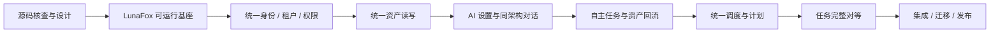

# 实施阶段与验收计划

本文将设计拆为连续可运行交付。除 M0 已完成的源码设计工作外，其余均为待实施项；阶段完成必须有构建产物、测试记录和可复现的验收步骤。

## 1. 交付顺序



优先让每阶段的服务、数据与界面闭环，再扩大能力。功能表不以“已有菜单”“返回 mock”“仅编译通过”作为完成依据。

## 2. M0：源码核查与设计基线

本轮已交付：

- 两个上游提交及源码定位、复用和耦合清单。
- 单前端/Go 核心后端的模块边界、菜单和 ARTEX 功能对等清单。
- 资产字段映射、租户权限、AI 图与测试关系、入库事务和迁移设计。
- 已执行的静态架构/UI 边界检查与 Go 测试版本阻断记录。

本轮没有复制产品源码、修改上游代码、安装新工具链、连接业务数据库、启动扫描或完成 AI 联调。项目代码实施从 M1 开始。

## 3. M1：在 SkyShield 建立可运行的 LunaFox 产品基座

### 工作内容

1. 使用本轮提交的 LunaFox 受版本管理源码建立 `SkyShield/frontend/server/contracts/engine-go/extensions/resources/deploy` 等基线，排除 `.git`、缓存和构建临时文件；保留许可、来源和所需不可变 Agent 产物。
2. 建立 SkyShield 自身版本管理与 upstream 来源记录，不依赖上级目录是 Git 仓库，也不把 ARTEX 完整复制成第二个运行服务。
3. 准备满足 `go >= 1.26.10` 的固定工具链，核对 Go 模块和锁定的 Norma 依赖可用性；使用项目声明 pnpm `10.30.3`。不因本机仅有 Go 1.24.6 而降低 go.mod。
4. 在独立数据库、端口、卷和 Compose 项目内构建原后端与前端，配置引擎安装/工作流目录和原扫描节点。已有部署和现有镜像不能当作本轮代码构建成功的证据。
5. 将可见品牌、网页标题、元数据、登录信息和部署入口改为“天穹”；保留 LunaFox 布局与主题。协议标识、签名、digest 不批量改名。
6. 核实 Server/Frontend 来源许可、闭源扫描 Agent 使用/分发和节点授权边界，列入发行材料；不修改或绕过现有 Agent 授权机制。
7. 建立天穹自己的构建/发布清单，停止沿用上游自动更新去覆盖定制程序的路径。

### 阶段产物

可构建的原能力产品基线、独立开发部署、环境说明、构建记录、原页面视觉基线和源码来源清单。

### 验收

前后端生产构建通过；空库原迁移成功且重复启动无 DDL 漂移；可以登录、管理组织/目标、查看原资产风险、配置工作流并在隔离测试目标上完成至少一次真实扫描。原有服务未被停止、覆盖或迁移。

若扫描 Agent 不满足可用条件，应明确将“扫描节点运行验证”标为未完成并继续非依赖工作；不能宣称整个基线已通过。

## 4. M2：统一身份、租户、权限和执行主体

### 工作内容

- 扩展 `identity`、Auth Claims、TokenVersion/授权版本、租户成员和角色；为已有数据建立默认租户。
- 迁移业务归属、自然键和复合 FK；完成旧仓储 Context/租户约束调用链，包括列表、Get、批量、统计、导出、删除和文件读取。
- 将 `/mcp`、SSE、下载 grant、媒体读取、Agent gRPC、后台任务纳入统一授权。现有 MCP 静态 key 的部署级范围不能直接成为多租户默认范围。
- 将静态集成 key 绑定租户服务主体和权限，保存不可逆校验或受控密文，不暴露明文。
- 对闭源扫描 Agent 采用每节点绑定单一租户的保守执行安排，Server 领取任务时验证绑定；在无法验证节点内部隔离前不混跑不同租户任务。
- 接入审计及 secret reference，确定普通请求、调度器、迁移工具和运维角色的数据库权限；完成 RLS 与连接池隔离测试。

### 阶段产物与验收

同一实例内两个租户可以使用相同域名、组织名和资产值；互相看不到数据，猜 ID、分页游标、导出链接、截图、日志、MCP、SSE 和旧 Token 都不能跨租户读取。计划身份被停用后不会继续获得执行资格。

验收同时执行 HTTP、应用服务、Repository/RLS 三层检查。通过前不开放多租户生产入口，不能仅靠用户界面的租户切换器宣称隔离完成。

## 5. M3：统一资产身份与原资产双向互通

### 工作内容

- 新增 `assetregistry` 和实体/扩展/绑定/范围/来源表，保留原资产与快照 ID。
- 先实现基于本地样例和历史快照的回填 dry-run、幂等写入、检查点和计数报告。
- 在原扫描入库事务及旧资产 CRUD、批量导入、删除、Target cleanup 等写路径接入统一登记。
- 实现六类查询、DSL 适配、企业归属、多 Target 和来源关系；处理 method UNKNOWN、DNS 缺失、IPv6、原始 URL 和 BIGINT。
- 增加“资产与风险 → 资产”页面，沿用原表格、过滤、详情抽屉；保留原 Target 下所有资产页和扫描快照。
- 预留 AI 工具调用的应用 Port，并用服务级调用验证回流，不等待完整 AI 运行时才验证模型正确性。

### 阶段产物与验收

真实扫描资产能在新六类页面查询；通过统一入库命令创建的可投影 Website/Endpoint 等出现在原 Target 资产页；新增应用/IPv6 信息可见且有明确投影说明。原始 URL、HTTP method、DNS 类型和记录来源不丢失。任意中间写入失败不产生半条成功关系。

不允许以定时将 LunaFox 表复制到 ARTEX assets 的脚本代替本阶段。

## 6. M4：AI 设置与 ARTEX 同架构对话

### 工作内容

1. 移植 `agent/provider.go`、LLM pool/health/usage，建立租户模型配置及受控连通测试。
2. 将 Agent、Prompt、MCP、Skill、工具的配置查询改为实例依赖；逐个移除 ToolAugment/ToolResolve/PromptOverride 的跨租户全局可变状态。
3. 适配 `ChatAgent` 的 Norma Session、Transcript Resume、Compaction、Capture、Settlement、可选 noa 和 Skill/MCP 历史解锁。
4. 移植 MCP stdio/HTTP/SSE、Skill 文件/上传校验、内置工具和自定义工具配置；优先原 schema 与事件语义。
5. 建立隔离 Runner 和文件/网络/凭据边界；审批、取消、输出及异常回收进入统一执行接口。
6. 完成五类 AI 设置页面、独立对话页、活动查询、使用统计和工具执行页。Query Key、缓存、目录、连接和模型限流全部隔离。

### 阶段产物与验收

用户从 AI 设置配置模型 → 创建 Agent 对话 → 调用已授权工具/MCP/Skill → 看到真实活动和执行记录 → 停止 → 刷新或重启后恢复多轮上下文。

没有真实模型密钥时先用确定性 Provider fixture 验证全部执行链；真实 LLM 联调必须另外记录，不把 fixture 结果标成真实模型验收。未配置模型不影响普通 ASM 页面。

该阶段完成独立对话，不意味着任务内 MainAgent 或自主任务已完成。

## 7. M5：自主 AI 任务与资产、风险闭环

### 工作内容

- 迁移 Goals/Planner/Worker/Engine 和所需探索仓储；先保留原调度算法、取消原因、图状态与事件去抖机制。
- 增加 TaskRepository、图/锚点 Port、FindingRecorder、预算与执行租约；保持用户任务状态、排队状态、Job 状态分离。
- `list_assets/insert_assets` 等领域工具接入 AssetRegistry，任务创建、Scope、意图、事实和测试引用统一资产 ID。
- 移植任务内 MainAgent 对话、分段、hint/intent、目标/约束管理和 Worker 实时纠偏。
- AI 工具通过共享 Scan 应用服务发起原工作流扫描，建立 AI task/intent 与 Scan 的关联；执行结果从原 ResultIngest 回到统一资产。
- 将 finding、基础证据和资产测试关系接入 Security；风险页与 AI 任务页展示关联结果。
- 完成任务列表、创建和详情的总览/会话/探索图/资产/发现等基础界面。

### 阶段产物与验收

选择已有资产创建 AI 任务 → 目标拆解与规划 → Worker 真实执行 → 发现新资产和问题 → 原资产及风险页可见 → MainAgent 能读取同一结果继续规划。

可暂停、恢复、停止、纠偏，进程退出后不会盲目重放外部工具操作。人工授权范围与模型可提出的 Scope 分开；“发现一个资产”不能自动标为已完成安全测试。

## 8. M6：统一调度、AI 计划任务与 Agent 触发器

### 工作内容

- 复用 LunaFox occurrence/handoff 的锁、幂等与重试经验，实现统一 Job/准入/租约协调器。
- 将原扫描 Cron 控制器以适配器接入同一服务生命周期和治理，保留现有 workflow/configuration/inputSource 与错过时点的语义。
- 移植 ARTEX Calendar 计算及状态变更：once/weekly、起止日期、跨日、立即运行、时区、窗口并集、人工暂停保护、手动有效期及历史。
- 移植 Agent 间隔/事件触发的串并行和合并策略，事件持久化、租户水位与去重。
- 完成 AI 计划任务页面、关联任务、状态及历史；保留原扫描定时页面。

### 阶段产物与验收

同一任务在开放窗口运行，窗口外暂停；多个计划不相互错误暂停；人工暂停不被自动恢复。扫描 Cron 仍按原规则生成 Scan。两个协调实例竞争时不会重复交付同一个业务动作，旧租约状态写入被拒绝。

不以“新增一个 cron 字段”替代 ARTEX 计划功能，也不把每个窗口误实现成新建一项任务。

## 9. M7：补齐任务完整对等与迁移支持

### 工作内容

- 任务分类/模板、父子与继承、冷图摘要、历史查询、完整并发/模型链行为、超时和多种收尾配置。
- 任务级/全局拦截及审批、审批详情和侧问、凭据处理、情报、流量录制与证据绑定。
- 报告、发现分组/审查、复测与复测结论、资产覆盖图、Token/工具/Skill 消耗。
- 归档/恢复、共享资产删除语义、任务与文件一致性、删除屏障和执行 drain。
- 可选 ARTEX 存量导入器及 ScopeSentry 外部来源适配；明确“新产品运行所需”和“用户已有数据导入所需”两种验收范围。
- 校对所有原 ARTEX 功能入口到天穹入口的映射，对照 C/E/T/S 编号逐项验收。

### 阶段产物与验收

任务详情内所有原能力可操作且数据关联真实，完整对等清单无未说明缺口。数据导入在有源测试快照时验证图/活动/文件引用、幂等和恢复；没有源数据库时标明“导入器已测试的样本范围”，不能宣称用户存量迁移成功。

## 10. M8：企业化集成、构建与发布

### 工作内容

- 完整运行前后端、数据库、扫描 Agent/Engine、AI Runtime/Runner 的集成流程，验证非 mock 运行。
- 干净安装、存量升级、失败中断、备份恢复和原始文件/证据一致性演练。
- 多租户越权/凭据泄露/工作目录越界、调度竞争、取消后写入、队列配额和资源耗尽回归。
- UI 原有流程回归、中文文案、浅深色/移动端/键盘操作与视觉对比。
- 按实际目标资产量和任务并发设定性能验收并采集数据；不凭设计先宣称百万级资产或任意并发。
- 生成可复现镜像、校验和、迁移与升级清单、来源许可清单、中文部署/使用/恢复说明和测试报告。

### 发布完成定义

用户要求的 AI 工作台四项、资产入口及五类 AI 设置均可用；LunaFox 原能力保持；统一资产互通、租户权限和恢复门槛通过；没有仅有入口的空实现，也没有未标注的 Skip、mock 或真实模型测试缺失。

## 11. 第一轮代码改造清单

以下按实际依赖顺序推进，每一项在 SkyShield 的基线内实施，不改原上游目录。

| 工作包 | 主要代码位置 | 必须随代码交付的验证 |
| --- | --- | --- |
| 基座来源与构建 | `server/go.mod`、`frontend/package.json`、lockfile、Dockerfile、deploy | 后端 build、前端 typecheck/build、空库迁移和就绪检查 |
| 身份与租户 | `internal/auth`、`middleware`、`modules/identity`、所有相关仓储、前端 auth hooks | 双租户 API/DB/文件隔离，续期和权限撤销 |
| 统一资产入口 | `modules/assetregistry`、`asset/application`、`resultingest`、snapshot wiring | 身份幂等、事务回滚、原始 URL/方法/IPv6 和跨 Target |
| ARTEX Core Port | `internal/airuntime`、`bootstrap/wiring/aiworkbench` | 原 Agent 行为测试迁移、无 concrete Store/全局租户钩子 |
| 模型和工具配置 | `modules/aisettings`、LLM/MCP/Skill/Tool adapters | 不同租户配置并发，密钥脱敏、禁用和版本隔离 |
| 对话与执行账本 | `modules/aiworkbench`、Runner、frontend AI hooks/components | Resume、调用配对、终止、审批、分页游标和大输出 |
| 任务与扫描桥接 | Engine/Manager adaptation、Scan 应用 Port、Risk Port | AI→Scan→ResultIngest→资产→AI 全链路 |
| 调度统一 | `modules/scheduling`、scheduledscan adapters、Calendar/Trigger handlers | 重复执行、并发、时区、人工暂停与恢复 |

## 12. 测试策略

### 12.1 复用原测试，新增融合边界测试

优先保留 ARTEX 对 Provider、模型配额/重试、工具目录、延迟工具、侧问、取消原因、插入资产、范围、任务/图/计划的行为测试；保留 LunaFox 对 ResultIngest 批次和执行栅栏、快照/当前态、Target cleanup、定时交付、API 与 UI 边界的测试。

只为有风险的行为新增测试：跨系统身份映射、字段无损、事务一致性、租户隔离、调度竞争、会话恢复和完整用户流程。不为文案更名或简单可逆 UI 调整编写镜像实现的测试。

### 12.2 必须通过的融合用例

| 编号 | 测试场景 | 必须断言的结果 |
| --- | --- | --- |
| A01 | 同资产被扫描重复上报与 AI 再次登记 | 同租户复用实体，来源/观测可追踪，不产生独立主库重复 |
| A02 | 同一资产属于多个 Target/组织 | 关系均保留；删除一个 Target 不删其他来源资产 |
| A03 | 两租户有相同 URL/IP/组织名 | 实体及权限隔离，计数/错误信息也不泄露另一租户 |
| A04 | 旧 endpoint 无 method，AI 有 GET/POST | UNKNOWN/GET/POST 不合并，旧 URL 页面可见方法变体 |
| A05 | URL 尾斜线、大小写路径、百分号、query 差异 | 原始证据原样保存，检索/候选等价不修改身份 |
| A06 | DNS 未采集、空值、IPv6、缺失 host | 不编造字段，不覆盖已知记录，不违反旧表约束 |
| A07 | BIGINT/NULL/异常状态值及响应截断 | 数值精度、空值和截断标志完整保留 |
| A08 | 事务中资产登记/旧投影/统计任一步故障 | 已承诺业务单位整体回滚，未提交 ID 不被返回成功 |
| A09 | Agent Session 更换、Scan 取消、Target 删除后迟到结果 | 原执行栅栏拒绝写入，新增注册表也无残留 |
| A10 | AI 工具一批多个资产，单项无效 | 保留 ARTEX 逐项结果语义；每个成功项内部一致 |
| C01 | 多轮对话、刷新/重启、压缩后继续 | 可恢复 Transcript，不只恢复展示消息 |
| C02 | Skill 解锁 MCP 后恢复会话 | 按历史重建解锁，未授权工具仍不可调用 |
| C03 | 流式建立前错误、部分输出后错误 | 正确切换/报错；不重复工具副作用或混用模型计量 |
| C04 | 审批后改参/权限撤销/Run 终止 | 旧审批不能执行新参数或越权调用 |
| E01 | 相同 toolCallId 出现在不同 Run/会话 | 输入输出精确配对，不串账，缺失结果不默认为成功 |
| E02 | 工具超时、取消、崩溃、输出过大 | 资源回收、结果状态、Artifact 和审计可查询 |
| T01 | 任务 pause/resume/steer/timeout/删除竞争 | 状态一致，取消原因正确，删除屏障生效 |
| T02 | AI 下发原生扫描并消费结果 | 完整应用校验/冻结/入库链保持，资产与任务锚点互通 |
| T03 | 创建/读取/插入资产但未真正测试 | 不标记测试完成或“安全”，粗略覆盖指标解释准确 |
| S01 | once/weekly、跨日/结束日期、时区/DST | 窗口计算正确，时间统一 UTC |
| S02 | 多计划窗口并集、人工暂停/手动运行到期 | 计划不错误恢复或暂停其他合法窗口任务 |
| S03 | 多调度实例、重启、水位、旧租约写回 | 业务实例幂等，过期 Worker 写入被拒绝 |
| P01 | REST/MCP/媒体/导出/SSE/日志/后台的跨租户请求 | 所有边界一致拒绝，缓存及连接池不串租户 |
| P02 | Runner 文件/网络/凭据边界、同节点租户安排 | 工具不能访问核心或其他租户资源；节点绑定有效 |
| M01 | 回填/导入重复、中断、失败及恢复 | 可续跑、映射无歧义、计数可核对、源数据完整 |

### 12.3 构建和测试入口

基座落地后，沿用并调整这些现有入口；新模块追加定向测试，不用一个总命令掩盖没有执行的集成检查：

```bash
# SkyShield/server，使用固定的兼容 Go 工具链
go build -o bin/server ./cmd/server
make check-architecture
go test -short ./...

# SkyShield/contracts、engine-go 及实际变更的 Engine 各自执行
go test ./...

# SkyShield/frontend，使用项目声明的 pnpm 版本
pnpm install --frozen-lockfile
pnpm typecheck
pnpm check:ui-foundation
pnpm test
pnpm build
```

数据库集成、并发与迁移测试使用独立、可销毁的测试库，环境变量与用例按原项目约定设置，并检测 Skip。对 ARTEX 使用会执行 cleanup 的测试前，必须确认 DSN 指向新建测试库；对 LunaFox 保留其测试库名称前缀检查。

迁移后的 ARTEX 行为测试以天穹的新包路径运行。源 ARTEX 的 `go test ./agent ./db ./server` 仅用于独立测试库中的上游参考验证，不允许连接天穹业务库去执行旧 `db.Open/schema.sql`。

Runtime/Runner 的停止和并发变更使用针对性的 `go test -race`、多实例 PostgreSQL 测试及进程重启测试。通过的检查仅在新变更、失败或新风险出现时重跑相关范围，避免用无差别重复测试代替交付。

前端端到端先跑变更路由和交互用例，再覆盖原组织、目标、扫描、资产和风险关键流程；真实后台验收关闭 Mock/Skip Auth。新增页面在浅色、深色及移动端与 LunaFox 视觉基线比较。

## 13. 首条端到端验收脚本的业务步骤

这是后续测试脚本必须实现的用户流程，不是本轮已执行结果：

1. 创建两个测试租户与不同权限成员，登录租户 A。
2. 在 A 创建测试组织、域名 Target，并执行原扫描工作流。
3. 在原资产页和统一资产页核对同一资产及来源，记录统一 assetEntity ID。
4. 在 AI 设置配置可测试模型、Agent、工具/MCP/Skill，进行独立对话并验证恢复。
5. 基于第 3 步资产创建 AI 任务，观察目标、意图、工具和资产锚点。
6. AI 登记新 Website/Endpoint，原 Target 页面立即可读；已有资产再次登记复用 ID。
7. 任务发现登记风险，任务页和风险页能追溯资产、证据和复测。
8. 设置 AI 运行窗口，验证暂停/恢复及人工暂停；同时确认原 Cron 扫描继续正常。
9. 重启核心/Runner，检查会话、计划、计量、执行状态与未知结果处理。
10. 登录租户 B，验证前述资源、订阅、文件、计数和导出均不可见。
11. 在独立环境演练备份恢复，再核对数据库关系与文件摘要。

## 14. 已知条件与处理方式

| 条件 | 对实施的影响 | 处理方式 |
| --- | --- | --- |
| 本机兼容 Go 工具链尚未建立 | 当前不能声称已编译或测试通过 | M1 使用固定兼容版本/构建镜像验证；不修改源码版本门槛掩盖问题 |
| LunaFox 扫描 Agent 无源码 | 无法在原节点里自由增加功能 | 保留协议与产物，AI 走 Server；更换节点另立经过授权的任务 |
| Server/Frontend 许可范围及闭源产物边界 | 影响对外发行材料 | 记录并核实，不猜测完整开源或闭源再分发权利 |
| 尚无真实模型配置 | 真实供应商兼容性未验证 | 确定性 fixture 先推进；真实联调使用受控配置并单独报告 |
| 尚无用户存量数据库样本 | 无法承诺真实历史数据迁移成功 | 本地合成快照演练、提供 dry-run；获取明确样本后补迁移验收 |
| 项目规模、目标并发未指定 | 不能给可靠容量与工期承诺 | 先建立可运行闭环及测量基线，再按真实规模排期优化 |

这些条件不改变本文的实施顺序；可以继续的工作持续推进，依赖条件未满足的验收明确保留为未完成。
