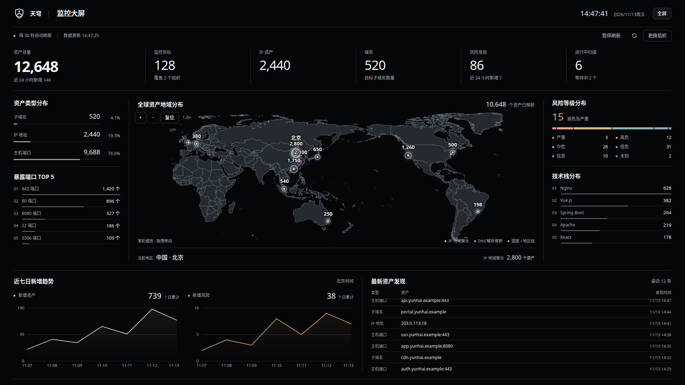
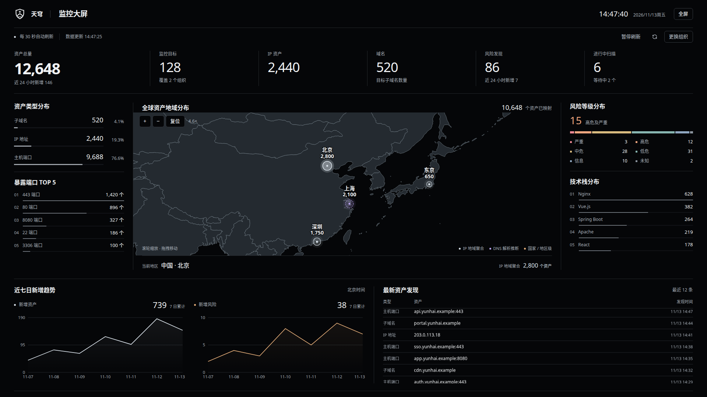

# 资产监控大屏

工作台菜单的「总览」下方为「监控大屏」。在组织选择页搜索并跨页勾选最多 50 个组织，选择配色后点击「确定」在新标签页打开大屏。不同标签页可以展示不同组织范围和配色；地址包含组织 ID 和配色，打开或刷新仍需登录。

大屏内容：

- 资产总量、监控目标、IP 资产、域名（目标子域名数量）、风险发现、进行中扫描与近 24 小时新增数量。域名指标紧邻 IP 资产右侧，使用所选组织范围内的去重子域名统计。
- 亚太地区居中的完整世界地图。支持鼠标滚轮缩放、拖拽移动、加减缩放和复位，最大放大 64 倍。落点大小和数字表示关联资产数量；放大或选中落点后显示城市名称，下方显示国家、地区、城市及定位来源。
- 子域名、IP、主机端口分布，风险等级分布，暴露端口前五名、技术栈、近七日新增趋势及滚动展示的最近 50 条资产。按首次发现时间从新到旧排序，不足 50 条时展示实际数量。
- HTTP/HTTPS URL 按域名或 IP 及端口统计；未显式指定端口时分别使用 80 和 443。同一主机端口的不同 URL 路径不会重复计数。域名端口和 IP 端口分别计数。
- 在组织选择页可选鎏金、深海蓝、暮光紫、青黛和暗夜黑五套配色，选择会保存在当前浏览器；大屏支持自动刷新和浏览器全屏。

展示布局以地图为中心，左侧为资产类型与端口排行，右侧为风险等级与技术栈，下方为新增趋势与最新发现。统一使用天穹标志、简洁标题和分隔线，资产总量作为主指标。新增资产和新增风险分别绘图，使用独立纵轴，并显示对应七日累计；风险摘要中的「高危及严重」仅汇总这两个等级的已记录发现，不表示未修复数量。底部不再显示组织范围标签和说明栏；桌面布局利用剩余屏幕高度放大地图与图表，避免高分辨率屏幕下的大面积底部空白。窄屏或较矮窗口可在大屏内滚动访问全部内容，最新发现仅在记录超出可见区域时滚动。

地图底图随产品打包，不依赖浏览器中的地图服务或地图 API Key。IP 定位复用后端已有地理位置协调器并遵循系统 HTTP 代理。每个资产只选择一个定位：优先使用已记录公网 IP；缺少公网 IP 时，通过 `dns.google` 获取域名当前公网解析地址并标记为「DNS 解析推断」；已有 FOFA 国家信息可使用国家中心点。DNS 推断不会更改扫描记录，也不证明扫描时 IP 或端口开放状态。无法定位的资产保留为待定位，代理生成的 `198.18.0.0/15` 等虚拟 IP 不会被当作公网地址。过期的成功定位继续显示为历史定位。

城市名称优先使用 [FreeIPAPI 的城市字段](https://freeipapi.com/docs/api-reference/get-ip-info)，中文界面通过随产品打包的 [GeoNames](https://www.geonames.org/) 与 [Natural Earth](https://www.naturalearthdata.com/) 地名数据转换为简体中文，并结合国家和坐标区分同名城市。城市字段缺失或无法翻译时，只有坐标与附近城市足够接近且结果明确才显示「坐标附近城市（推断）」，否则提示城市信息暂缺。城市位置来自公网 IP 或 DNS 推断，并不代表设备的精确物理位置；仅有国家信息时保持国家级定位。新增迁移 `000077_asset_monitor_city_locations` 保留已有坐标，并安排旧成功记录逐步刷新城市信息。地图不再以粗坐标网格合并相邻城市，缩放后标记和标签保持稳定大小并重新避让。

总数按子域名、IP、主机端口去重，总览页使用相同的统计口径。多个组织共享同一目标或资产时，总计只计一次；展示组织仍由选择页和大屏地址中的组织 ID 确定。资产、风险和扫描均限定在所选组织及当前有效目标内，删除目标的数据会退出大屏。趋势表示北京时间每天的实际新增记录，不推算历史资产存量。暴露端口按不同主机端口数量排序，同一端口上的域名和 IP 分别计数。

首次打开时，未定位的公网 IP 和域名会在后台逐步补齐。单次快照最多提交 16 个待查公网 IP 和 16 个域名，数据库和进程协调器共同去重；DNS 成功结果一小时刷新，IP 成功定位保留七天，查询失败间隔 15 分钟重试。内网和代理虚拟 IP 不发送给定位服务。接口响应不等待外部定位完成。

刷新失败时保留上次成功快照并明确标记；首次请求失败、组织已删除、空组织和无地区信息分别显示对应状态。

实现入口：

- 前端选择页：`frontend/app/asset-monitor/page.tsx`
- 独立大屏：`frontend/app/asset-monitor/screen/page.tsx`
- 后端接口：`GET /v1/assetMonitors/current?organizationIds=1,2`
- 迁移：`000027_asset_monitor_locations`、`000029_asset_inventory_statistics`、`000030_asset_inventory_parser` 和 `000031_asset_monitor_dns`，包含 IP、DNS 缓存和统计投影。

本地升级：扫描任务全部结束后，在 SkyShield 目录执行 `./local.sh start`，脚本会重新构建、执行编号迁移并启动服务。有运行中扫描时，部署脚本会拒绝中断 Agent。

验证包括独立 PostgreSQL 中的组织范围、共享目标去重、删除目标剔除、匿名和非成员访问拒绝、IP 定位入队去重，前端范围与地理位置单元测试、登录外壳与侧栏回归、生产构建，以及桌面和移动端浏览器交互。

浏览器验收可用 `frontend/scripts/test-asset-monitor-ui.mjs` 对独立预览实例运行；脚本使用隔离的合成数据，覆盖组织多选、选择页配色、新标签和偏好恢复、完整世界地图、全屏、刷新暂停、失败保留、空数据和移动端溢出。

下图是合成数据的布局验收截图，不是当前组织的真实资产统计：

城市缩放示例（合成验收数据）：

